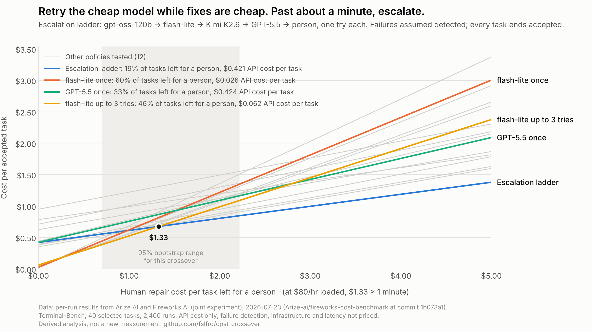

# cpst-crossover

**At what human repair cost does a cheaper, less reliable AI model stop being the cheaper way to get work done?**

This repository computes cost per successful task (CPST), the repair-cost crossover between models, and the cost of retry and escalation policies, from published benchmark results. It is a calculator over cited data. It runs no models and makes no new measurements.


## The result, from published data

Using the [Arize and Fireworks benchmark](https://arize.com/blog/cost-per-successful-task-ai-model-benchmark/) of ten models on 40 Terminal-Bench tasks (2,400 runs, July 2026), with one attempt per task and every failure repaired by a person:

- With **no human repair cost**, the cheapest model per attempt is cheapest per accepted task. This is the token-price view.
- The two cheapest models, gpt-oss-120b and gemini-3.1-flash-lite, trade places at about $0.11 per failure, but their reliability gap is **not resolved** by the data. Treat them as tied.
- At about **$1.47 per failure**, roughly **a minute of human time** at $80 an hour, GPT-5.5 becomes the cheapest per accepted task. From Arize's per-run results, the 95% bootstrap range for that crossover is **$0.86 to $3.18**, roughly 40 seconds to two and a half minutes. Against gpt-oss-120b instead, the crossover is $1.20 (range $0.78 to $2.01). Kimi K3 is statistically indistinguishable from GPT-5.5 here.
- Above that, the gap widens. At $4 per failure, GPT-5.5's loaded cost is about 28% below gemini-3.1-flash-lite's.

## Retries and escalation change the answer



Comparing single models assumes one attempt, then a person. Arize also published every individual run, so a policy can be priced: retry a model, hand off to a stronger one, and only then to a person. With the same repair assumption, and assuming every failure is caught:

- **Up to about $1.33 per failure** (a minute at $80 an hour), the cheapest policy is retrying gemini-3.1-flash-lite up to three times.
- **Above that**, Arize's own escalation ladder is cheapest: gpt-oss-120b, then flash-lite, then Kimi K2.6, then GPT-5.5, one try each, then a person. It costs about the same in API spend as GPT-5.5 alone ($0.421 against $0.424 per task) and leaves **19% of tasks for a person instead of 33%**.
- **GPT-5.5 alone is never the cheapest policy** in the set tested. Above $0.82 per failure the ladder beats it in at least 97.5% of bootstrap replicates.
- 3 of the 40 tasks were never solved by any model in 60 attempts each. They reach a person under every policy, so 7.5% is the floor.

The retry results depend on catching failures reliably. The benchmark's tests do that; a production workflow needs its own check. Full tables and sensitivity: [POLICIES.md](POLICIES.md).

Full single-model tables, including every pairwise crossover: [RESULTS.md](RESULTS.md). Assumptions, uncertainty and what is published versus derived: [METHODOLOGY.md](METHODOLOGY.md).

## What this is not

- **Not a model ranking.** It shows how the cheapest choice depends on repair cost, on one benchmark.
- **Not a measurement of repair cost.** Repair cost is a swept parameter.
- **Not evidence about your workload.** The benchmark is 40 command-line tasks. Measure your own pass rates and put them in the CSV.

## Quickstart

Python 3.9 or later. The core needs nothing beyond the standard library on 3.11+ (`tomli` on older versions); the chart needs matplotlib.

```bash
pip install -e '.[figures]'

python -m cpst fetch                        # download Arize's per-run results (pinned, checksummed)

python -m cpst report > RESULTS.md          # single-model tables
python -m cpst policies > POLICIES.md       # retry and escalation policies
python -m cpst report --hourly 120          # different loaded labor rate
python -m cpst figure                       # figures/crossover.png
python -m cpst policy-figure                # figures/policies.png

python -m unittest discover -s tests        # arithmetic and data checks
```

`fetch` saves the per-run results to `data/external/`, which is gitignored: Arize's repository has no license file, so this project links to the data instead of copying it. Without it, `report` and `figure` fall back to the approximate uncertainty range and `policies` is unavailable.

```
```

## Use your own numbers

Add a CSV to `data/` with these columns, and an entry in `data/sources.toml` pointing to it:

| Column | Meaning |
|---|---|
| `model`, `provider` | Names |
| `pass_rate` | Fraction of attempts that meet your acceptance bar, 0 to 1 |
| `cost_per_attempt_usd` | Mean cost per attempt, **including failed attempts** |
| `cost_per_success_usd` | Optional, used only for cross-checks |

Keep each dataset to one task set and one acceptance bar. The calculator compares models only within a dataset, because CPST from different task sets or success definitions isn't comparable.

Then run `python -m cpst --dataset <your_key> report`.

## Layout

```
data/
  arize_terminalbench_2026-07.csv   published figures, one row per model
  sources.toml                      citations, dates, checksums, caveats, excluded sources
  external/                         per-run results from `fetch` (gitignored)
src/cpst/
  model.py                          CPST, loaded CPST, crossover, envelope
  policies.py                       retry and escalation policies, bootstrap
  data.py, fetch.py                 loaders, pinned download
  report.py, policy_report.py       generate RESULTS.md and POLICIES.md
  figures.py                        both charts
tests/                              arithmetic, simulation check, reproduction of Arize's figures
METHODOLOGY.md
RESULTS.md, POLICIES.md             generated
```

## Chart palette

Highlighted series use the first four categorical slots of a palette validated for color-vision deficiency and normal-vision separation on a light surface (blue `#2a78d6`, orange `#eb6834`, aqua `#1baf7a`, yellow `#eda100`). Aqua and yellow sit below 3:1 contrast on the surface, so every highlighted line is directly labeled and the generated tables carry the same numbers.

## Related writing

- [*Look Beyond Token Prices: What Does Successful AI Work Cost?*](https://www.linkedin.com/pulse/look-beyond-token-prices-what-does-successful-ai-work-faisal-fareed-lvd9c/) by Faisal Fareed. The case for measuring cost per successful task.
- *Cheap Models Stop Being Cheap at About a Minute* by Faisal Fareed. The results in this repository. Link: `<article URL>`.

## License

MIT. See [LICENSE](LICENSE). Figures in `data/` are reproduced from the cited sources for analysis; refer to those sources for their terms.
