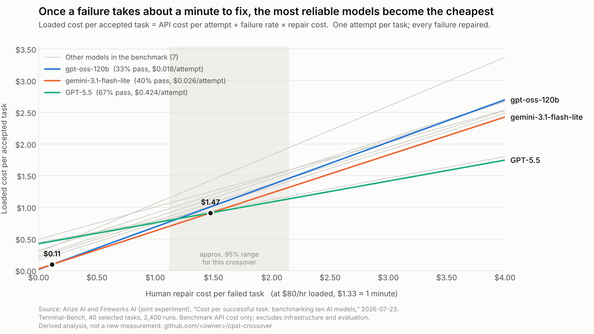

# cpst-crossover

**At what human repair cost does a cheaper, less reliable AI model stop being the cheaper way to get work done?**

This repository computes cost per successful task (CPST) and the repair-cost crossover between models, from published benchmark results. It is a calculator over a cited dataset. It runs no models and makes no new measurements.



## The result, from published data

Using the [Arize and Fireworks benchmark](https://arize.com/blog/cost-per-successful-task-ai-model-benchmark/) of ten models on 40 Terminal-Bench tasks (2,400 runs, July 2026), with one attempt per task and every failure repaired by a person:

- With **no human repair cost**, the cheapest model per attempt is cheapest per accepted task. This is the token-price view.
- The two cheapest models, gpt-oss-120b and gemini-3.1-flash-lite, trade places at about $0.11 per failure, but their reliability gap is **not resolved** by the data. Treat them as tied.
- At about **$1.47 per failure**, roughly **a minute of human time** at $80 an hour, GPT-5.5 becomes the cheapest per accepted task. The approximate 95% range for that crossover is **$1.12 to $2.15**. Against gpt-oss-120b instead, the crossover is $1.19 (range $0.96 to $1.59). Kimi K3 is statistically indistinguishable from GPT-5.5 here.
- Above that, the gap widens. At $4 per failure, GPT-5.5's loaded cost is about 28% below gemini-3.1-flash-lite's.

Full tables, including every pairwise crossover: [RESULTS.md](RESULTS.md). Assumptions, uncertainty and what is published versus derived: [METHODOLOGY.md](METHODOLOGY.md).

## What this is not

- **Not a model ranking.** It shows how the cheapest choice depends on repair cost, on one benchmark.
- **Not a measurement of repair cost.** Repair cost is a swept parameter.
- **Not evidence about your workload.** The benchmark is 40 command-line tasks. Measure your own pass rates and put them in the CSV.

## Quickstart

Python 3.9 or later. The core needs nothing beyond the standard library on 3.11+ (`tomli` on older versions); the chart needs matplotlib.

```bash
pip install -e '.[figures]'

python -m cpst report                       # Markdown tables to stdout
python -m cpst report > RESULTS.md          # regenerate RESULTS.md
python -m cpst report --hourly 120          # different loaded labor rate
python -m cpst figure --out figures/crossover.png --lmax 4

python -m unittest discover -s tests        # arithmetic and data checks
```

## Use your own numbers

Add a CSV to `data/` with these columns, and an entry in `data/sources.toml` pointing to it:

| Column | Meaning |
|---|---|
| `model`, `provider` | Names |
| `pass_rate` | Fraction of attempts that meet your acceptance bar, 0 to 1 |
| `cost_per_attempt_usd` | Mean cost per attempt, **including failed attempts** |
| `cost_per_success_usd` | Optional, used only for cross-checks |

Then run `python -m cpst --dataset <your_key> report`.

## Layout

```
data/
  arize_terminalbench_2026-07.csv   published figures, one row per model
  sources.toml                      citations, dates, caveats, excluded sources
src/cpst/
  model.py                          CPST, loaded CPST, crossover, envelope
  data.py                           loaders
  report.py                         generates RESULTS.md
  figures.py                        the crossover chart
tests/test_model.py                 arithmetic, and reproduces the published CPST column
METHODOLOGY.md
RESULTS.md                          generated
```

## Chart palette

Highlighted series use the first three categorical slots of a palette validated for color-vision deficiency and normal-vision separation on a light surface (blue `#2a78d6`, orange `#eb6834`, aqua `#1baf7a`). Every highlighted line is also directly labeled, so identity never depends on color alone.

## Related writing

- [*Look Beyond Token Prices: What Does Successful AI Work Cost?*](https://www.linkedin.com/pulse/look-beyond-token-prices-what-does-successful-ai-work-faisal-fareed-lvd9c/) by Faisal Fareed. The case for measuring cost per successful task.
- *Cheap Models Stop Being Cheap at About a Minute* by Faisal Fareed. The results in this repository. Link: `<article URL>`.

## License

MIT. See [LICENSE](LICENSE). Figures in `data/` are reproduced from the cited sources for analysis; refer to those sources for their terms.
